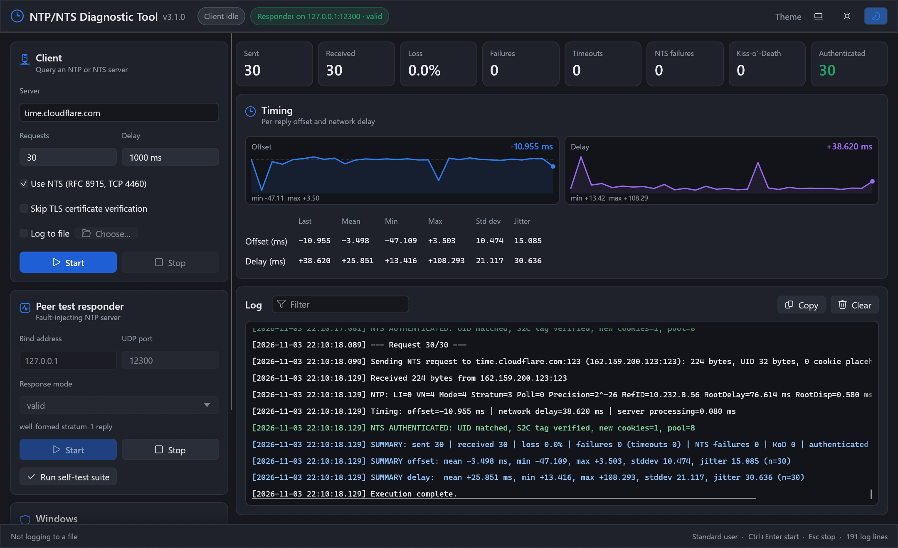

# NTP/NTS Diagnostic Tool

A diagnostic tool for **NTPv4** and **Network Time Security (RFC 8915)** servers, with a fault-injecting NTP responder for testing NTP clients and peers.

Version {{VERSION}} is written in Rust. It has a Windows installer, needs no runtime, and ships as two programs:

| Program | What it is for |
| --- | --- |
| `NTP-NTS-Diagnostic-Tool.exe` | The window: client, responder, live charts and log |
| `ntpnts.exe` | The same engine on the command line, for scripts and CI |

The source code is at [Optimusprimeums/ntp-nts-diagnostic-tool-rs]({{SOURCE_URL}}), where you can also [report an issue]({{SOURCE_URL}}/issues). Downloads are on the [releases page]({{REPO_URL}}/releases).

## Start here

- [Installing](Installing.md): the installer, the portable zip, upgrading and removing
- [Getting Started](Getting-Started.md): your first NTS test in a minute
- [The Window](The-Window.md): every card, button and counter

## Testing servers

- [Testing an NTP Server](Testing-an-NTP-Server.md)
- [Testing an NTS Server](Testing-an-NTS-Server.md)
- [Understanding Results](Understanding-Results.md)
- [Stability Testing](Stability-Testing.md)

## Testing clients and peers

- [Peer Test Responder](Peer-Test-Responder.md): 19 fault modes and the self-test suite
- [Windows Firewall and Administrator](Windows-Firewall-and-Administrator.md)

## Reference

- [Command Line](Command-Line.md)
- [Troubleshooting](Troubleshooting.md)
- [Security and Technical Notes](Security-and-Technical-Notes.md)
- [Building and Releasing](Building-and-Releasing.md)
- [Changelog](Changelog.md)
- [Version 2.x](Version-2.x.md): the earlier Python releases
